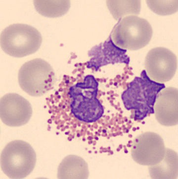

# White Blood Cell Differential Classifier (Explainable AI)

A clinical-grade, web-based White Blood Cell (WBC) differential classification and hematology explainability dashboard powered by Deep Convolutional Neural Networks and **Grad-CAM (Gradient-Weighted Class Activation Mapping)**.



---

## 🌟 Key Features

### 1. 7-Class Deep Learning Differential Classification
Trained and validated on peripheral blood smear microphotographs across seven leukocyte classes:
- **Basophils** (Allergic mediator, coarse dark blue-black granules)
- **Eosinophils** (Parasitic & allergic defense, bright red-orange granules, bilobed nucleus)
- **Lymphocytes** (Adaptive immunity, dense clumped nucleus, high N:C ratio)
- **Metamyelocytes** (Immature precursor - kidney/reniform nucleus, signals **Left Shift**)
- **Monocytes** (Phagocytic precursor, folded horseshoe nucleus, ground-glass cytoplasm)
- **Myelocytes** (Early precursor, round eccentric nucleus, pathological **Left Shift**)
- **Neutrophils** (First-line bacterial defense, 2–5 segmented lobes, neutral lilac granules)

---

### 2. Multi-Modal Explainability Engine
- **Grad-CAM Attention Heatmaps**: Real-time feature attribution generated by computing gradients of the predicted class score with respect to the final convolutional layer (`conv2d_5`, 128 filters, 28×28 feature maps).
- **Interactive Blend Opacity Slider**: Adjust the heatmap overlay blend from 0% (pure smear) to 100% (pure thermal activation).
- **Multiple Colormap Palettes**: Choose between `JET` (standard medical thermal), `Turbo` (high dynamic range), `Viridis` (perceptually uniform & colorblind accessible), and `Inferno`.
- **Dynamic Attention Core Bounding Box**: Pinpoints the exact region (nuclear lobulation, granules, chromatin density) that guided the CNN's decision.
- **Morphological Feature Attribution**:
  - Estimated **Nuclear-to-Cytoplasmic (N:C) Ratio**
  - **Acidophilic (Red) Granule Density** (Eosinophil indicator)
  - **Basophilic (Dark Blue) Granule Density** (Basophil indicator)
  - **Peak Activation Intensity** and feature localization notes

---

### 3. Hematology Lab 100-Cell Differential Counter
- **Standard Lab Bench Counter**: Progress bar tracking toward the 100-cell clinical threshold.
- **Keyboard Hotkeys**: Rapid counting using keys `1` through `7` or `+` to increment the classified cell.
- **Normal Range Comparison**: Flags differential percentages as *Normal*, *Elevated ⚠️*, or *Decreased 🔻* based on adult peripheral blood standard intervals.
- **Automated Left-Shift Detection**: Instantly alerts clinicians when immature precursors (**Metamyelocytes** or **Myelocytes**) are identified, highlighting potential acute bacterial sepsis, leukemoid reaction, or myeloproliferative disorders.

---

### 4. Interactive Preloaded Test Dataset Gallery
- Instant 1-click test cards for all 7 WBC classes extracted from `Testing datasets.zip`.
- Drag-and-drop custom blood smear image upload (JPG / PNG).
- Clipboard paste support (`Ctrl+V`).

---

### 5. WBC Reference Atlas & Diagnostic Report
- **Reference Atlas Modal**: Morphological reference table detailing cell diameter, nuclear shape, cytoplasm granulation, physiologic functions, and pathologic alerts.
- **Print / PDF Report**: Clean layout formatted for clinical summary printing and PDF export.

---

## 🚀 Quick Start

### 1-Click Launch (Windows)
Double-click `run_app.bat` in the project root:
```bat
run_app.bat
```
This automatically activates the isolated Python environment, starts the FastAPI server, and opens `http://localhost:8000` in your default browser.

### Manual Launch (Command Line)
```bash
# Activate virtual environment
.venv\Scripts\activate

# Start Uvicorn server
uvicorn app.main:app --host 0.0.0.0 --port 8000
```
Open **[http://localhost:8000](http://localhost:8000)** in any modern browser.

---

## 🛠️ API Documentation

| Method | Endpoint | Description |
| :--- | :--- | :--- |
| `GET` | `/` | Web interface HTML |
| `GET` | `/api/model-info` | CNN architecture parameters and layer hierarchy |
| `GET` | `/api/gallery` | Preloaded test dataset samples grouped by class |
| `POST` | `/api/classify` | Accepts either multipart image upload or JSON sample path; returns prediction, Grad-CAM heatmap, focus bbox, and morphology metrics |
| `POST` | `/api/differential/add` | Adds classified cell to laboratory 100-cell tally |
| `POST` | `/api/differential/reset`| Resets differential counter |
| `GET` | `/api/differential/summary`| Returns current differential breakdown and clinical left-shift flags |

---

## 🔬 Model Architecture

- **Input Shape**: `128 × 128 × 3` (RGB)
- **Pre-processing**: `Rescaling(1./255)`
- **Layer 1**: `Conv2D(32, (3,3), relu)` + `MaxPooling2D((2,2))`
- **Layer 2**: `Conv2D(64, (3,3), relu)` + `MaxPooling2D((2,2))`
- **Layer 3**: `Conv2D(128, (3,3), relu)` (`conv2d_5` - Grad-CAM Target) + `MaxPooling2D((2,2))`
- **Dense Layers**: `Flatten()` + `Dense(128, relu)` + `Dropout(0.5)` + `Dense(7, softmax)`
- **Total Parameters**: 3,305,543 (12.61 MB)

---

## ⚡ Deploying to Vercel

The application is fully compatible with **Vercel** for instant, serverless publishing.

### Why Vercel?
- **Client-Side Acceleration**: On Vercel, the web app utilizes **TensorFlow.js (WebGL/WASM)** directly in the visitor's browser.
- **Zero Server Costs & No Timeouts**: Because inference and Grad-CAM calculations run on the client device, you do not need expensive GPU servers or heavy Python environments on Vercel.
- **Optimized Assets**: Binary model weights (`12.61 MB`) and test datasets are pre-configured in `public/` and cached on Vercel's global CDN edge.

### How to Publish to Vercel:

#### Method 1: Using the Vercel CLI
```bash
# 1. Install Vercel CLI (if not already installed)
npm i -g vercel

# 2. Deploy directly from the project directory
vercel
```
Follow the interactive prompts (Accept defaults: project root `./`, output directory `public`).

#### Method 2: Git / GitHub Integration
1. Push this repository to **GitHub**, **GitLab**, or **Bitbucket**.
2. Go to **[vercel.com/new](https://vercel.com/new)** and import your repository.
3. Vercel will automatically detect `vercel.json` and deploy the `public` directory.
4. Click **Deploy** — your live link (e.g. `https://white-blood-cell-classifier.vercel.app`) will be ready in seconds!

